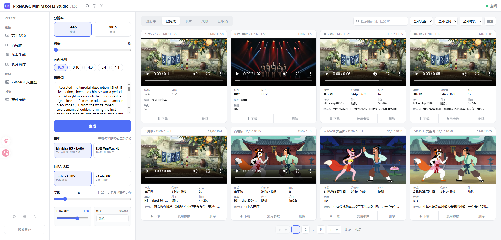

# H3 Studio — 本地视频生成工作台

仿 [minimax-h3-studio](https://github.com/zxcHolmes/minimax-h3-studio) 的本地 Web 工作台，驱动本机 ComfyUI 出片。左侧选模式 → 中间调参数 → 右侧看任务卡片流，队列自动 FIFO 执行。零额外依赖：直接复用 ComfyUI 自带的 Python 运行。

> 仓库：https://github.com/pixelaigc/h3-studio · License: MIT

## 界面



*H3 Studio v1.00 实机截图（作者本地生产环境）。左：模式与参数面板；右：已完成任务卡片流（此页为文生视频作品），可直接播放、下载、复用参数或删除。*

截图里可以看到：

- **顶栏**：`PixelAIGC MiniMax-H3 Studio v1.00`，右侧状态点显示「空闲」
- **任务区**：进行中 / 已完成 / 长片 / 失败 / 已取消分页，可按提示词与任务 ID 搜索，并按类型、比例、时长筛选

- **顶栏**：右侧实时显示「Generating, N 排队 / 空闲 / ComfyUI 未连接」
- **左侧栏**：视频（文生视频 / 首尾帧 / 参考生成 / 长片拼接）· 图像（Z-IMAGE 文生图）· 系统（硬件参数）· 释放显存
- **参数面板**：分辨率 544p/768p、模型卡（H3+LoRA / 标准 H3）、LoRA 选择与强度、步数 4~20、画面比例、时长 5~15s、种子
- **任务卡片**：排队/生成中进度条（与 ComfyUI 逐节点/逐采样步实时同步）、可播放预览、Cancel、下载、复用参数、删除
- **硬件参数页**：GPU（显存/利用率/温度/功耗/驱动）、CPU、内存、磁盘、软件环境（ComfyUI/PyTorch/Python/OS）、模型库分类统计，3 秒自动刷新

## 模式与模型映射

| 模式 | 工作流节点 | 说明 |
|---|---|---|
| 文生视频 t2v | `MiniMaxH3ImageToVideo` | 纯提示词，带原生音频 |
| 首尾帧 flf | `MiniMaxH3ImageToVideo` | first_frame / last_frame（尾帧可省略=图生视频） |
| 参考生成 r2v | `MiniMaxH3ReferenceToVideo` | 1~3 张参考图，主体一致性 |
| 文生图 t2i | Z-IMAGE-turbo | 8 步出图 |

**模型档位**（需已就位 MiniMax-H3 权重，见下方「前置准备：ComfyUI 与模型权重」）：

| 选项 | unet | clip | 步数 |
|---|---|---|---|
| H3 + LoRA（ckpt850 / v4-step600） | `minimax_h3_*_pruned_int8_convrot` 或 nvfp4 | qwen3vl（随精度切换） | 4 |
| 标准 MiniMax-H3 | 同上 | 同上 | 20 |
| 精度切换 | int8 convrot（质量）/ nvfp4（省显存） | — | — |

## 长片拼接

把已经生成的片段接成一条长片，不用再开剪辑软件：

1. 左侧栏进入「长片拼接」
2. 把要拼接的视频片段拖入左侧的框中，按先后顺序排好
3. 一键拼接，输出一条完整的长片

拼接在本机由 ffmpeg 完成，不经过 ComfyUI，也不重新生成画面。**前提：本机已安装 ffmpeg 并加入系统 PATH**（命令行输入 `ffmpeg -version` 能显示版本号即可）。没装 ffmpeg 只是拼接不可用，其他生成模式不受影响。

## 前置准备：ComfyUI 与模型权重

H3 Studio 不是独立的生成引擎，它驱动本机已经装好的 ComfyUI 出片。开始前备齐下面几样：

1. **ComfyUI**：已安装、能正常启动（默认监听 `127.0.0.1:8188`），且带有 MiniMax H3 相关节点（`MiniMaxH3ImageToVideo` / `MiniMaxH3ReferenceToVideo`）；缺节点时先更新 ComfyUI。
2. **MiniMax H3 权重**（放入 ComfyUI 的 `models/` 对应目录）：
   - `diffusion_models/` — `minimax_h3_fl2va_*`、`minimax_h3_ref2va_*`（int8 convrot 或 nvfp4 二选一，与文本编码器精度配套）
   - `text_encoders/` — `qwen3vl_32b_minimax_h3_*`（int4 convrot 或 nvfp4 awq）
   - `vae/` — `minimax_h3_video_vae_fp16.safetensors`、`minimax_h3_audio_vae_fp32.safetensors`
3. **Turbo LoRA**（放入 `models/loras/`）：`minimax_h3_turbo_4step_ema_ckpt850.safetensors`、`minimax_h3_turbo_v4_step600_ema.safetensors`；选「H3 + LoRA」档位时要用，只用标准 H3 档位可暂缺。
4. **Z-IMAGE 权重**（文生图模式要用，同样放入 `models/` 对应目录）：
   - `diffusion_models/` — `z_image_turbo_bf16.safetensors`
   - `text_encoders/` — `qwen_3_4b.safetensors`
   - `vae/` — `ae.safetensors`
5. **ffmpeg**：仅长片拼接需要，装好并加入 PATH。

> H3 权重从哪下、总控参数怎么调，见配套仓库 [ComfyUI-MiniMax-H3-Workflow](https://github.com/pixelaigc/ComfyUI-MiniMax-H3-Workflow)：那边是同一套 H3 生产的 ComfyUI 节点工作流，附 H3 权重文件的官方下载链接与目录表；本仓库是它的可视化工作台，两边配合使用。

## 安装与运行

1. **把本仓库放到任意目录**：克隆或下载 ZIP 解压都行，路径不限，例如 `D:\h3s`。
2. **首次使用先建配置**：把 `config.example.json` 复制一份、改名为 `config.json`，按你的环境修改：

```json
{
  "host": "0.0.0.0",
  "port": 8190,
  "comfyui_url": "http://127.0.0.1:8188",
  "data_dir": "./data",
  "models_dir": "<你的ComfyUI目录>/ComfyUI/models",
  "poll_interval": 1.5
}
```

> `models_dir` 仅用于「硬件参数」页的模型库统计，留空则跳过。

3. **先启动 ComfyUI**：确认它已在 `127.0.0.1:8188` 运行，且上面的 H3 / Z-IMAGE 权重都已就位。Studio 顶栏会实时显示 ComfyUI 的连接状态，连不上先解决这边。
4. **双击仓库目录下的 `启动.bat`**：脚本会自动探测 ComfyUI 自带的 Python 运行 `server.py`（零额外依赖）。如果你的 ComfyUI 不在脚本默认的 `D:\ComfyUI`，先用记事本把 `启动.bat` 里的 `COMFY_DIR` 改成你的实际目录；没启动 ComfyUI 时脚本会先提醒，并询问是否仍要启动 Studio。
5. **浏览器打开 `http://127.0.0.1:8190`** 即可使用；局域网内的手机也可以访问 `http://<本机IP>:8190`。

## 数据

- `data/jobs.db` — 任务队列与历史（SQLite）
- `data/outputs/<job_id>/` — 成片 / 成图
- `data/uploads/` — 上传的首尾帧 / 参考图

## HTTP API

| 方法 | 路径 | 说明 |
|---|---|---|
| POST | `/api/jobs` | multipart 提交任务（mode + params JSON + 图片文件） |
| GET | `/api/jobs?status=` | 任务列表（queued/running/done/failed/canceled/all） |
| POST | `/api/jobs/{id}/cancel` | 取消（排队从队列删，运行中触发 interrupt） |
| DELETE | `/api/jobs/{id}` | 删除已完成记录及输出 |
| GET | `/api/system` | 队列与 ComfyUI 状态 |
| GET | `/api/hardware` | 本机硬件参数（GPU/CPU/内存/磁盘/软件/模型库） |
| POST | `/api/unload` | 释放 ComfyUI 显存 |

## 时长→帧数

与官方工作流一致：`max(5, round(秒*24)) + (5 - max(5, round(秒*24)) % 17) % 17`，24fps 对齐 17 帧约束。

## 致谢

- [zxcHolmes/minimax-h3-studio](https://github.com/zxcHolmes/minimax-h3-studio)（UI 灵感来源）
- [Comfy-Org MiniMax-H3](https://huggingface.co/Comfy-Org/MiniMax-H3) 模型
