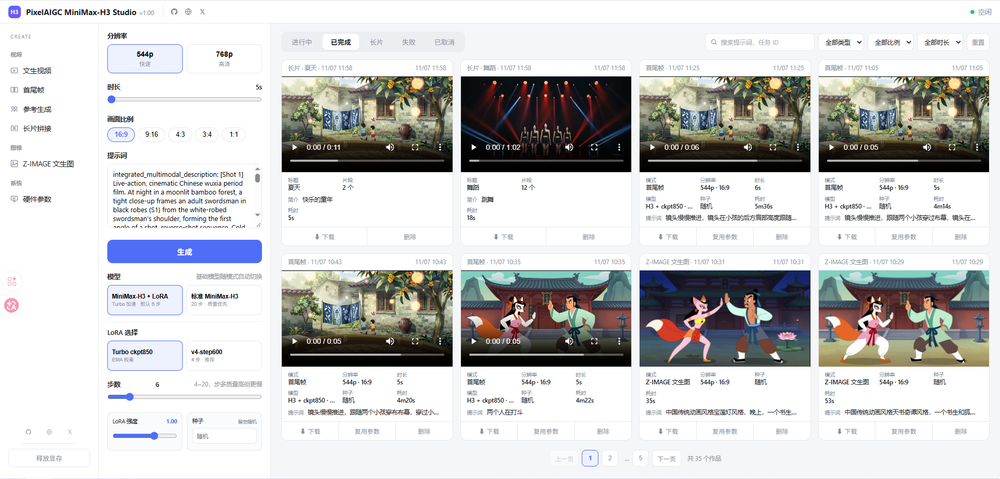

<div align="center">

# ComfyUI-MiniMax-H3 Studio — 本地视频生成工作台

[](LICENSE)   

**不用学节点图，也能用 MiniMax H3 在本地出片。**

本地 Web 工作台，驱动本机 ComfyUI 生成视频与图片。左侧选模式 → 中间调参数 → 右侧看任务卡片流，队列自动 FIFO 执行。零额外依赖，直接复用 ComfyUI 自带的 Python 运行。UI 灵感来源：[zxcHolmes/minimax-h3-studio](https://github.com/zxcHolmes/minimax-h3-studio)。

</div>



<p align="center"><sub>v1.00 实机截图（作者本地生产环境）· 左：模式与参数面板 · 右：已完成任务卡片流</sub></p>

## 它解决什么痛点

- **界面门槛高** — ComfyUI 节点图对新手不友好，参数散落在十几个节点里；这里把已验证的工作流藏到后台，只留选模式、写提示词、调参数、点生成。
- **生产资产难管** — 成片不再散落在输出目录里找不回：每次生成都是任务卡片，带提示词与参数，可搜索、筛选、播放、下载、一键复用参数。
- **长片合成麻烦** — 分段生成后不必再进剪辑软件：内置长片拼接一键成片，还能让 AI 智能体一句话生成整条长片（见文末）。

## 功能一览

- **文生视频 / 首尾帧 / 参考生成** — MiniMax H3，Turbo LoRA 加速（默认 6 步）或标准 H3（20 步）
- **Z-IMAGE 文生图**
- **任务队列与卡片流** — 进度与 ComfyUI 实时同步，进行中 / 已完成 / 长片 / 失败 / 已取消分类管理
- **长片拼接** — 片段拖入、一键成片（ffmpeg）
- **硬件参数页** — GPU / CPU / 内存 / 硬盘 / 软件环境 / 模型库六项实时状态，附一键释放显存

## 界面

- **顶栏**：`PixelAIGC ComfyUI-MiniMax-H3 Studio v1.00`，右侧实时显示「Generating, N 排队 / 空闲 / ComfyUI 未连接」
- **左侧栏**：视频（文生视频 / 首尾帧 / 参考生成 / 长片拼接）· 图像（Z-IMAGE 文生图）· 系统（硬件参数）· 释放显存
- **参数面板**：分辨率 544p/768p、模型卡（H3+LoRA / 标准 H3）、LoRA 选择与强度、步数 4~20、画面比例、时长 5~15s、种子
- **任务卡片**：排队/生成中进度条、可播放预览、Cancel、下载、复用参数、删除；可按提示词与任务 ID 搜索，按类型、比例、时长筛选
- **任务标签**：`全部`（默认，不按状态过滤）/ 进行中 / 已完成 / 长片 / 失败 / 已取消
- **生成批次**：文生图可一次出 1~5 张，各批次独立种子、独立状态，单批次失败不影响其余批次；单条任务卡内可展开「批次结果」缩略图网格，逐批次看状态并点开大图
- **LoRA 配置**：文生图面板可挂多个本机已安装的 Z-Image LoRA，逐个调强度（0~1，0=关闭）、排序、启停、删除，并可查看每个 LoRA 的显示名 / 路径 / 触发词 / 推荐强度 / 适用场景；配置存服务端，局域网共用
- **图片查看器**：生成结果缩略图点击即开大图（hover 显示放大图标、光标变 `zoom-in`），支持缩放 / 适应屏幕 / 原始尺寸 / 滚轮 / 方向键 / 拖拽平移 / Esc 关闭，并可直接下载原图或在新窗口打开；纯前端实现，局域网所有客户端一致生效
- **硬件参数页**：GPU（显存/利用率/温度/功耗/驱动）、CPU、内存、磁盘、软件环境（ComfyUI/PyTorch/Python/OS）、模型库分类统计，3 秒自动刷新

## 模式与模型映射

| 模式 | 工作流节点 | 说明 |
|---|---|---|
| 文生视频 t2v | `MiniMaxH3ImageToVideo` | 纯提示词，带原生音频 |
| 首尾帧 flf | `MiniMaxH3ImageToVideo` | first_frame / last_frame（尾帧可省略=图生视频） |
| 参考生成 r2v | `MiniMaxH3ReferenceToVideo` | 1~3 张参考图，主体一致性 |
| 文生图 t2i | Z-IMAGE-Turbo / Z-Image Base / DarkBeast Z6 FP8 | 分辨率档位 + 画面比例 + 采样参数可选，默认值对齐 ComfyUI 官方模板 |

**模型档位**（需已就位 MiniMax-H3 权重，见下方「前置准备：ComfyUI 与模型权重」）：

| 选项 | unet | clip | 步数 |
|---|---|---|---|
| H3 + LoRA（ckpt850 / v4-step600） | `minimax_h3_*_pruned_int8_convrot` 或 nvfp4 | qwen3vl（随精度切换） | 4 |
| 标准 MiniMax-H3 | 同上 | 同上 | 20 |
| 精度切换 | int8 convrot（质量）/ nvfp4（省显存） | — | — |

**图像面板档位**（文生图模式，`/api/image-options` 下发，可选项只列本机实际存在的权重）：

| 模型版本 | unet | 采样器 / 调度器 / 步数 / CFG / shift | 负面提示词 |
|---|---|---|---|
| Z-Image-Turbo（默认） | `z_image_turbo_bf16.safetensors` | `res_multistep` / `simple` / 8 / 1.0 / 3 | 不提供（CFG=1 时被跳过） |
| Z-Image Base | `z_image_bf16.safetensors` | `res_multistep` / `simple` / 25 / 4.0 / 3 | 提供（官方强烈建议） |
| DarkBeast Z6 BlitZ | `DarkBeastZ6-BlitZ-Scaled-Fp8-Mixed-ComfyUI.safetensors` | `euler` / `simple` / 15 / 1.0 / 3 | 不提供 |

分辨率档位按**总像素**定义（与 ComfyUI `ResolutionSelector` 同算法，宽高对齐到 16 的倍数）：
`1MP`（官方默认 1024×1024）/ `480P` / `720P` / `1080P` / `1440P` / `2K` / `4K`，
可配 `1:1` `2:3` `3:2` `3:4` `4:3` `9:16` `16:9` `21:9` 八种比例，宽高可手动微调。

三个需要注意的约束（面板上已标注）：
- **Turbo 的 CFG 必须 = 1**：ComfyUI 在 CFG≈1 时把 uncond 置空、不跑第二遍前向，负面提示词数学上无效，故 Turbo 档位下该输入框被禁用。
- **Turbo 不要用 `karras` / `exponential` 调度器**（8 步下会崩图）；Base 非蒸馏，`exponential` 采样器反而可用 —— 所以采样器/调度器下拉列表按模型版本区分。
- **≥3MP 不直出**：Z-Image 原生超过约 4MP 会崩图，`1440P` 以上的档位自动改走官方 2K 放大路径（低分辨率生成 → RealESRGAN 放大 → `dpmpp_2m_sde`+`beta` 5 步 denoise 0.33 二次细化）。

### 图像页的两处交互约定

**1）图像页不显示顶部的快捷分辨率卡片。** 视频 / 首尾帧 / 参考生成等模式仍保留「544p 快速 / 768p 高清」快捷选择；文生图模式只有「分辨率档位 + 画面比例 + 输出尺寸」这一套联动控件，避免两套分辨率语义并存。

**2）提示词区自上而下为「输入框 → 增强按钮 → 生成按钮」**，并带未增强拦截：

| 场景 | 行为 |
|---|---|
| 提示词未增强就点「生成」 | 弹出确认框「当前提示词尚未增强，是否直接用原始提示词生成？」；**确认**用原始提示词继续生成，**取消 / 关闭 / Esc** 中止本次生成（不会自动开始增强） |
| 提示词已增强（回填后带「已增强」徽标） | 直接生成，不再弹窗 |
| 用户手动编辑过提示词 | 「已增强」标记立即失效，重新按「未增强」处理 |
| 增强进行中 | 增强按钮显示「正在增强…」并禁用，生成按钮同时禁用；完成后恢复 |
| 生成进行中 | 增强按钮与生成按钮同时禁用，文案变为「生成中…」，避免并发重复提交 |

> 拦截只在文生图模式生效，视频模式流程不变。

### 4）生成批次（1~5 张）

文生图面板可设置「生成批次」（1~5，默认 1）。一次提交 N 张时，服务端会拆成 N 个**独立批次**：

- 每批次有独立的种子（基准种子 + 批次序号，或完全随机），出图互不相同
- 每批次有独立的 `status` / `progress` / `error` / 产物，**单个批次失败只标记该批次 `failed`，其余批次照常跑完**
- 任务整体状态 = 有任一批次成功即 `done`（产物为所有成功批次的合集），全部失败才 `failed`
- 任务卡内点「批次结果」可展开缩略图网格，逐批次看状态，点缩略图可直接放大

### 5）Z-Image LoRA

文生图面板底部有 LoRA 配置区，可添加多个 LoRA、逐个调强度、排序、启停、删除。

**清单只列本机实际存在的文件**（与 ComfyUI 自己的 lora 下拉同源，扫描 `extra_model_paths.yaml` 声明的所有 loras 目录）。本机当前有 4 个 Z-Image LoRA：

| 显示名 | 文件 | 基础模型 | 触发词 | 推荐强度 |
|---|---|---|---|---|
| 如梦似幻（滤镜） | `Kook_Zimage_如梦似幻.safetensors` | Z-Image（Turbo） | `如梦似幻` | 1.0 |
| 瑶光（真实幻想） | `Kook_Zimage_瑶光.safetensors` | Z-Image（Turbo） | `瑶光` / `真实幻想` | 1.0 |
| 蒸馏加速 8 步（2603） | `Z-Image-Fun-Lora-Distill-8-Steps-2603-ComfyUI.safetensors` | Z-Image Base | 上游未标注 | 1.0 |
| 蒸馏 LoRA（本地抽取版 rank64） | `z-image/Z-Image-Fun-Distill-Lora.safetensors` | Z-Image | 上游未标注 | 1.0 |

> 「如梦似幻」「瑶光」的触发词来自上游 ModelScope README 的 tags（`KookYan/Kook_Zimage_Rmsh` / `KookYan/Kook_Zimage_Yg`）；
> 蒸馏 LoRA 的 baseModel=**ZImageBase**、推荐 8 步 CFG 1（来自 Civitai 2362961 / HF `alibaba-pai/Z-Image-Fun-Lora-Distill`）。
> 上游没写触发词的就留空，不编造。

**保存配置时会校验文件是否真实存在**，不存在直接返回 400 报错，不静默忽略。配置存在服务端（`model_provider_prefs` 表），局域网所有客户端共用同一份。

工作流注入：`UNETLoader → ModelSamplingAuraFlow → LoraLoaderModelOnly × N → KSampler`。
用 `LoraLoaderModelOnly`（只改 model 不动 clip）是因为 Z-Image 的文本编码走独立的 `CLIPLoader(lumina2)`，风格 LoRA 应当只作用在 UNet 侧。

### 3）生成结果图片可放大查看

「已完成」页（以及任何出现图片结果的地方）的缩略图都可点击打开大图查看器：

| 能力 | 说明 |
|---|---|
| 打开方式 | 点击缩略图；或 Tab 聚焦后按 Enter / Space（缩略图带 `role="button"` 与 `aria-label`） |
| 默认尺寸 | 按图片原始尺寸显示，但不超过视口；原始尺寸大于视口时自动缩放到「适应屏幕」，需要看细节再手动放大 |
| 缩放 | 工具栏 `－` / `＋`，键盘 `-` / `+`，鼠标滚轮（以光标位置为锚点缩放），范围 5%~1600% |
| 视口切换 | 「适应屏幕」（或 `0` 键）/「原始尺寸」（或 `1` 键） |
| 平移 | 图片大于视口时可滚动、鼠标拖拽、或方向键平移 |
| 关闭 | `Esc`、右上角 `×`、点击图片外的遮罩区（点到图片本身不会关闭） |
| 导出 | 查看器内「下载原图」「新窗口打开」；任务卡片操作区也有「⬇ 下载」与「↗ 新窗口打开」 |

实现为纯前端 + 现有 `/files` 静态路由，**不新增任何仅本机可用的路径**，局域网所有客户端（`http://<本机IP>:8190`）表现一致；历史图片结果同样适用。

## 前置准备：ComfyUI 与模型权重

H3 Studio 不是独立的生成引擎，它驱动本机已经装好的 ComfyUI 出片。开始前备齐下面几样：

1. **ComfyUI**：已安装、能正常启动（默认监听 `127.0.0.1:8188`），且带有 MiniMax H3 相关节点（`MiniMaxH3ImageToVideo` / `MiniMaxH3ReferenceToVideo`）；缺节点时先更新 ComfyUI。
2. **MiniMax H3 权重**（放入 ComfyUI 的 `models/` 对应目录）：
   - `diffusion_models/` — `minimax_h3_fl2va_*`、`minimax_h3_ref2va_*`（int8 convrot 或 nvfp4 二选一，与文本编码器精度配套）
   - `text_encoders/` — `qwen3vl_32b_minimax_h3_*`（int4 convrot 或 nvfp4 awq）
   - `vae/` — `minimax_h3_video_vae_fp16.safetensors`、`minimax_h3_audio_vae_fp32.safetensors`
3. **Turbo LoRA**（放入 `models/loras/`）：`minimax_h3_turbo_4step_ema_ckpt850.safetensors`、`minimax_h3_turbo_v4_step600_ema.safetensors`；选「H3 + LoRA」档位时要用，只用标准 H3 档位可暂缺。
4. **Z-IMAGE 权重**（文生图模式要用，同样放入 `models/` 对应目录）：
   - `diffusion_models/` — `z_image_turbo_bf16.safetensors`
   - `text_encoders/` — `qwen_3_4b.safetensors`
   - `vae/` — `ae.safetensors`
5. **ffmpeg**：仅长片拼接需要，装好并加入 PATH。

> H3 权重从哪下、总控参数怎么调，见配套仓库 [ComfyUI-MiniMax-H3-Workflow](https://github.com/pixelaigc/ComfyUI-MiniMax-H3-Workflow)：那边是同一套 H3 生产的 ComfyUI 节点工作流，附 H3 权重文件的官方下载链接与目录表；本仓库是它的可视化工作台，两边配合使用。

## 安装与运行

1. **把本仓库放到任意目录**，路径不限，例如 `D:\h3s`。两种办法任选：

   **办法一：git 克隆（复制即用）**

   ```bat
   git clone https://github.com/pixelaigc/ComfyUI-MiniMax-H3-Studio.git D:\h3s
   cd D:\h3s
   ```

   以后更新只需在该目录执行 `git pull`。没装 git 也可以在仓库页面点 Code → Download ZIP，解压到 `D:\h3s`，效果一样。

   **办法二：交给 AI 智能体个性化安装**

   把下面这段原样粘贴给你的 AI 智能体（如 Muse、Cursor 等），它会按你这台电脑的实际情况完成安装：

   ```text
   请根据我本地电脑的实际情况，把 ComfyUI-MiniMax-H3 Studio 安装到 D:\h3s：
   仓库地址：https://github.com/pixelaigc/ComfyUI-MiniMax-H3-Studio
   要求：
   1) 先检查本机 ComfyUI 的安装目录和运行状态（默认 127.0.0.1:8188），再克隆仓库到 D:\h3s（目录已存在则先确认里面是什么，不要直接覆盖）；
   2) 按仓库 README 的「前置准备」逐项核对 MiniMax H3、Z-IMAGE 权重与 Turbo LoRA 是否已在 ComfyUI 的 models 对应目录中，缺哪个明确告诉我，不要未经我同意就下载大文件；
   3) 把 config.example.json 复制为 config.json，models_dir 填我本机的实际路径；如果我的 ComfyUI 不在 D:\ComfyUI，把 启动.bat 里的 COMFY_DIR 改成实际目录；
   4) 检查 ffmpeg 是否已安装并在 PATH 中（长片拼接要用），没有就告诉我怎么装；
   5) 最后先启动 ComfyUI，再双击 D:\h3s\启动.bat，确认浏览器能打开 http://127.0.0.1:8190，并向我报告每一步的结果和还缺什么。
   ```
2. **首次使用先建配置**：把 `config.example.json` 复制一份、改名为 `config.json`，按你的环境修改：

```json
{
  "host": "0.0.0.0",
  "port": 8190,
  "comfyui_url": "http://127.0.0.1:8188",
  "data_dir": "./data",
  "models_dir": "<你的ComfyUI目录>/ComfyUI/models",
  "poll_interval": 1.5
}
```

> `models_dir` 仅用于「硬件参数」页的模型库统计，留空则跳过。

3. **先启动 ComfyUI**：确认它已在 `127.0.0.1:8188` 运行，且上面的 H3 / Z-IMAGE 权重都已就位。Studio 顶栏会实时显示 ComfyUI 的连接状态，连不上先解决这边。
4. **双击仓库目录下的 `启动.bat`**：脚本会自动探测 ComfyUI 自带的 Python 运行 `server.py`（零额外依赖）。如果你的 ComfyUI 不在脚本默认的 `D:\ComfyUI`，先用记事本把 `启动.bat` 里的 `COMFY_DIR` 改成你的实际目录；没启动 ComfyUI 时脚本会先提醒，并询问是否仍要启动 Studio。
5. **浏览器打开 `http://127.0.0.1:8190`** 即可使用；局域网内的手机也可以访问 `http://<本机IP>:8190`。

**关闭 Studio**：服务是在后台独立运行的，关掉浏览器页面、关掉启动窗口都不会停它（启动窗口按任意键消失后，服务照样在跑）。要真正关闭，先查 8190 端口的进程号，再结束它：

```bat
netstat -ano | findstr :8190
taskkill /PID <LISTENING 那一行的进程号> /F
```

认准 `LISTENING` 那行的 PID，别误杀 `ESTABLISHED` 另一端的号码（那是浏览器）。也可以在任务管理器里结束对应的 python 进程。注意这只关 Studio，ComfyUI（8188）是另一个程序，要单独关闭。

## 数据与输出目录

所有数据都在安装目录的 `data\` 下（`config.json` 的 `data_dir`，默认即仓库目录下的 `data`）。生成完成后，成片会从 ComfyUI 复制到这里统一管理，以 `D:\h3s` 为例：

| 内容 | 目录 | 文件名 |
|---|---|---|
| 生成的视频 | `D:\h3s\data\outputs\videos\` | `v-h3-studio-000001.mp4`（顺序编号） |
| 长片拼接的成片 | `D:\h3s\data\outputs\videos\` | `v-l-000001.mp4` |
| 生成的图片（Z-IMAGE） | `D:\h3s\data\outputs\images\` | `i-zimage-000001.png`（顺序编号） |
| 上传的首尾帧 / 参考图 | `D:\h3s\data\uploads\` | — |
| 任务记录（提示词、参数、状态） | `D:\h3s\data\jobs.db` | SQLite 数据库 |

在界面里删任务卡片，对应文件会一并删除；直接去上面目录里取文件也行，拷走不影响任务记录。

## HTTP API

| 方法 | 路径 | 说明 |
|---|---|---|
| POST | `/api/jobs` | multipart 提交任务（mode + params JSON + 图片文件） |
| POST | `/api/longfilms` | 长片拼接：提交已生成片段，ffmpeg 拼接为一条长片 |
| GET | `/api/jobs?status=` | 任务列表（queued/running/done/failed/canceled/all） |
| POST | `/api/jobs/{id}/cancel` | 取消（排队从队列删，运行中触发 interrupt） |
| DELETE | `/api/jobs/{id}` | 删除已完成记录及输出 |
| GET | `/api/system` | 队列与 ComfyUI 状态 |
| GET | `/api/hardware` | 本机硬件参数（GPU/CPU/内存/磁盘/软件/模型库） |
| POST | `/api/unload` | 释放 ComfyUI 显存 |
| GET | `/api/providers` | 本地模型 Provider 列表 + 默认项设置 |
| POST | `/api/providers` | 新增 Provider（显示名/类型/Base URL/模型名/API Key/多模态/启用） |
| PUT | `/api/providers/{id}` | 修改 Provider（`api_key` 留空表示保持原值） |
| DELETE | `/api/providers/{id}` | 删除 Provider（同时清掉指向它的默认项） |
| POST | `/api/providers/{id}/default` | 设为默认 Provider；body `{"multimodal":true}` 设为默认多模态模型 |
| POST | `/api/providers/{id}/test` | 连通性探测（不生成内容） |
| GET | `/api/image-loras` | 本机实际存在的 Z-Image LoRA 清单 + 当前配置 |
| PUT | `/api/image-loras` | 保存 LoRA 配置（校验文件存在，存服务端） |
| GET | `/api/enhancer` | 提示词增强 Agent 的模板清单与参数 |
| PUT | `/api/enhancer` | 保存用户可编辑的模板覆盖与参数 |
| POST | `/api/enhance` | 提示词增强（`prompt` + `mode`=replace/append + `spec_id` + `provider_id`） |
| POST | `/api/moss-layout` | MOSS 结构化增强（`prompt` + `intent` + `width`/`height` + `provider_id`），产出 MOSS Layout JSON 与翻译后的文本提示词 |

## 本地模型 Provider

侧边栏「本地模型配置」页可管理本机运行的 LLM 服务，配置存在服务端 SQLite（`data/jobs.db`），
所有局域网客户端共用同一份，不是浏览器 localStorage。

支持的类型：

| 类型 | 端点 | 备注 |
|---|---|---|
| `openai` | `{base_url}/v1/chat/completions` | OpenAI 兼容 API（vLLM / SGLang / llama.cpp server / LM Studio 等） |
| `ollama` | `{base_url}/api/chat` | Ollama 原生协议 |
| `llamacpp` | `{base_url}/v1/chat/completions` | llama.cpp server |
| `comfyui` | ComfyUI 工作流 | 走 `VRGDG_LocalLLM` 节点，支持图片输入 |

「默认 Provider」用于一般文本调用；「默认多模态模型」单独指定，用于提示词增强等需要读图的场景。

## 提示词增强迷你 Agent

`h3studio/enhancer.py` 是独立模块，自带模板、参数与调用封装，后续复用到视频/音频提示词只需新增模板。

- 图像模板覆盖六个维度：主体 / 场景 / 构图 / 光线 / 风格 / 镜头
- 模板与参数可在「本地模型配置」页编辑并持久化（API Key 不回显明文）
- 图像页提示词框旁有「增强」按钮，结果可一键替换或追加（追加时保留原文）
- 本地模型不可达时返回明确错误并在界面提示，不会静默失败

### MOSS-Image 结构化增强（layout）

「增强」按钮是一个**分裂按钮**：主键执行当前增强方式，右侧 **▾ 箭头**展开下拉菜单。
下拉里每一项前面带**复选框**，可以**同时选中多项**（多选）。

点「增强」后按**选中顺序依次应用**各项：

| 增强项 | 接口 | 说明 |
|---|---|---|
| 普通增强 | `POST /api/enhance` | 按所选模板把提示词扩写成完整描述 |
| 二次增强 | `POST /api/enhance` | 把提示词里的物体逐个枚举并逐个细化 |
| 结构化增强（layout） | `POST /api/moss-layout` | 生成 MOSS Layout JSON（对象清单 + 位置坐标），并翻译成最终文本提示词 |
| qwen21图片官方增强PE | `POST /api/qwen-pe/expand` | 用 Qwen-Image 2.1 官方 PE 权重与官方 system prompt 扩写（文生图 / 图片编辑各一档，标 Recommended） |

多项同时选中时的规则：

- **链式输入** —— 后一项吃前一项的产出（真正的「依次应用」）
- **片段合并** —— 各项产出的片段合并追加到最终提示词，互不覆盖、不互相截断；
  合并后仍可在提示词框里手动编辑
- **参数叠加** —— 各项的推荐参数叠加套用，后一项只覆盖它自己声明的键，
  不会清掉前一项已套用的参数；已套用的参数在提示词框旁有可见回显
- **至少留一项** —— 取消最后一项时保持原状（避免「点增强没反应」）

其中 **结构化增强（layout）** 让本地模型把自然语言需求扩写成 MOSS **Layout JSON**
（对象清单 + 位置坐标），服务端做 schema 校验与坐标编译，再**确定性翻译**成最终文本
提示词送进 `CLIPTextEncode`。产物可查看、可编辑、可复制、可回填；Layout JSON 为官方格式
该选项**仅在 MOSS-Image 面板可用**（其它模型不认 layout 坐标）。
（`bbox_coord_space=abs_centralized`、`bbox_format=yxyx`）。

这是 ComfyUI-Moss 插件 `MossPrompt` 节点能力的**外部复现** —— 不接任何外部 API，
全程走本地模型 Provider。详见 [docs/MOSS结构化增强说明.md](docs/MOSS结构化增强说明.md)。

### Qwen-Image 2.1 官方 PE 提示词扩写（增强项）

官方 PE 扩写**不是独立勾选框**，而是「增强」下拉里的**一条普通增强项**
（`qwen21图片官方增强PE`，标 Recommended），只在 Qwen-Image 2.1 的文生图 /
图片编辑面板下可用。

该项自带两个可编辑字段：

- **官方 PE system prompt** —— 扩写所用的官方指令原文。编辑后，
  **扩写与出图共用同一份文本**（出图链路的 `params["pe_system_prompt"]`）。
- **推荐档位参数** —— `presence_penalty` / `max_new_tokens`
  （文生图 1.5 / 16256，图片编辑 0 / 24000）。
  **选中即自动套用**，用户可再改；套用结果在提示词框旁有可见回显。
  （`max_new_tokens` 不能压到 ComfyUI 模板的 4096 —— 官方文档警告
  「reasoning block 用完预算不会闭合，enhancer 返回空串」。）

官方 PE 双档 checkpoint **不可互换**：PE-T2I（文生图）与 PE-I2I（图片编辑）
是两个独立权重，档位随面板自动决定，填错不报错、只会悄悄改采样分布。

## 时长→帧数

与官方工作流一致：`max(5, round(秒*24)) + (5 - max(5, round(秒*24)) % 17) % 17`，24fps 对齐 17 帧约束。

## 长片拼接

把已经生成的片段接成一条长片，不用再开剪辑软件：

1. 左侧栏进入「长片拼接」
2. 把要拼接的视频片段拖入左侧的框中，按先后顺序排好
3. 一键拼接，输出一条完整的长片

拼接在本机由 ffmpeg 完成，不经过 ComfyUI，也不重新生成画面。**前提：本机已安装 ffmpeg 并加入系统 PATH**（命令行输入 `ffmpeg -version` 能显示版本号即可）。没装 ffmpeg 只是拼接不可用，其他生成模式不受影响。

## 进阶：一句话让智能体生成整条长片

Studio 带 HTTP API（见上方「HTTP API」），能访问你本机 `127.0.0.1:8190` 的 AI 智能体可以直接把它当制作平台用：一句话说清主题和规格，智能体按 H3 提示词规范把长片拆成每段 5 秒的分段提示词，逐段提交（队列自动 FIFO 执行），全部生成后用长片拼接接成一条成片返回给你。

示例（把下面这段粘贴给你的智能体即可）：

```text
http://127.0.0.1:8190/ 以这里为制作平台，根据H3提示词的写作规范，制作30秒韩国天团美少女跳舞的视频，背景是黑色背景的舞台，炫酷的灯光，以特写、中景、局部、脸部、手部特写为主，大师级运镜，每段5秒，一共6段，用默认方式，16:9，没有背景音乐，生成后拼接成一个30秒视频，返回给我
```

换成你自己的片子时，改这几处就行：**主题内容、总时长、每段秒数（常用 5 秒）、段数（= 总时长 ÷ 每段秒数）、画面比例、要不要背景音乐**。要点：

- 智能体必须能访问运行 Studio 的这台电脑（智能体装在本机最稳妥）；
- Studio 和 ComfyUI 要先开着（见「安装与运行」），长片拼接还要求 ffmpeg 已装好；
- 段数越多耗时越长：每段都是真实生成一遍，智能体会排队等全部完成再拼接，适合挂机批量出长片。

## 硬件参数与释放显存

左侧栏「系统 → 硬件参数」是整台机器的实时状态页，3 秒自动刷新，分六块：

| 板块 | 显示内容 |
|---|---|
| GPU | 显卡型号、显存占用 / 总量、利用率、温度、功耗、驱动版本 |
| CPU | 型号、物理核 / 线程数、使用率、当前频率 |
| 内存 | 总量 / 已用 / 可用与使用率，含交换文件 |
| 硬盘 | 各分区的总量 / 已用 / 剩余与使用率 |
| 软件环境 | 操作系统、ComfyUI / PyTorch / Python 版本、CUDA 设备 |
| 模型库 | 按分类统计 `models` 目录中权重文件的数量与占用空间（需在 `config.json` 里填 `models_dir`，留空则跳过） |

出片前先看一眼显存够不够、生成时盯一下温度和功耗、排查问题时核对软件版本，都在这页。

**释放显存**：左侧栏底部的「释放显存」按钮，点击后向 ComfyUI 发送卸载请求，把常驻显存的模型卸掉、释放显存占用。暂时不生成、要把显卡让给其他软件时点一下即可；下次生成时模型会自动重新加载，只是第一段会稍慢。

## 默认面板与任务列表

打开工作台默认停在 **Z-IMAGE 文生图**：左侧「CREATE → 图像 → Z-IMAGE 文生图」默认高亮，
中间参数区直接显示分辨率档位 / 画面比例 / 输出尺寸 / 模型 / 采样器 / 调度器 / 步数 / CFG / seed /
LoRA 这套图像参数。手动切到文生视频、首尾帧、参考生成、长片拼接时，导航高亮与参数区内容始终同步。

右侧任务区默认是「全部状态 + 全部类型」，首屏直接拉出已有任务，不需要再点一次「全部」。
「全部」标签带分页，所以「全部类型」下每一类（文生视频 / Z-IMAGE / 首尾帧 / 参考生成 / 长片拼接）
都能翻到。

前端资源用 `?v=` 版本号做缓存失效，首页 `index.html` 每次都回源校验（`Cache-Control: no-cache`），
升级后无需手动清缓存即可拿到新前端。

## 自动化测试

```bash
# 后端 + LoRA + 工作流（需要 ComfyUI 的 Python 环境：torch / safetensors）
/home/ubuntu/comfyui/venv/bin/python -m pytest tests/ -q

# 前端默认态（需要 playwright + chromium）
/usr/local/lib/hermes-agent/venv/bin/python -m pytest tests/test_frontend_defaults.py -q

# 状态栏实时性 + 素材库自动刷新（需要 playwright + chromium）
/usr/local/lib/hermes-agent/venv/bin/python -m pytest tests/test_status_realtime.py -q
```

`tests/test_frontend_defaults.py` 用真实浏览器打开真实 Studio 实例，断言：

- 默认高亮项是「Z-IMAGE 文生图」，参数区是图像面板（视频专属控件隐藏）；
- 手动切换模式时导航高亮与面板内容同步；
- 默认「全部 + 全部类型」下任务列表非空、可翻页、覆盖多种生成类型；
- 启动脚本**逐项隔离**：即便某个启动步骤抛异常，任务列表仍会自动加载（不依赖用户手动点一次）。

最后一条对应一个真实缺陷：`app.js` 顶层启动脚本里任何一处抛异常都会中断整段脚本，
连带 `refreshJobs()` 与 `setInterval(refreshJobs, 2000)` 都没注册 —— 表现为标签显示
「全部 / 全部类型」但列表空白，点一次才恢复。现在每个启动步骤单独 `try/catch`，
单点异常不再拖垮整页。

## 状态栏与素材库实时刷新

右上角状态栏与 ComfyUI 的**真实队列**保持一致，状态一变就通过 SSE 推给前端：

| 状态 | 显示 | 触发条件 |
|---|---|---|
| 空闲 | `空闲`（绿点） | ComfyUI 队列全空 |
| 生成中 | `生成中`（红点 pulsing） | ComfyUI 正在执行任务 |
| 排队中 | `排队中（N）` | 队列里有待执行的任务 |
| 断连 | `ComfyUI 未连接`（灰点） | 连不上 ComfyUI |

注意状态反映的是 ComfyUI 实际在跑什么 —— 不只是 Studio 自己提交的任务，
用户直接在 ComfyUI 页面提交的任务，Studio 也会显示「生成中」。

右侧历史/素材库每 2 秒自动增量刷新：生成完成的新条目（缩略图、状态、
参数）会自动出现在列表里，不需要手动刷新页面。未变化的卡片不会重建，
因此正在播放的视频不会被打断。

## 致谢

- [zxcHolmes/minimax-h3-studio](https://github.com/zxcHolmes/minimax-h3-studio)（UI 灵感来源）
- [Comfy-Org MiniMax-H3](https://huggingface.co/Comfy-Org/MiniMax-H3) 模型
